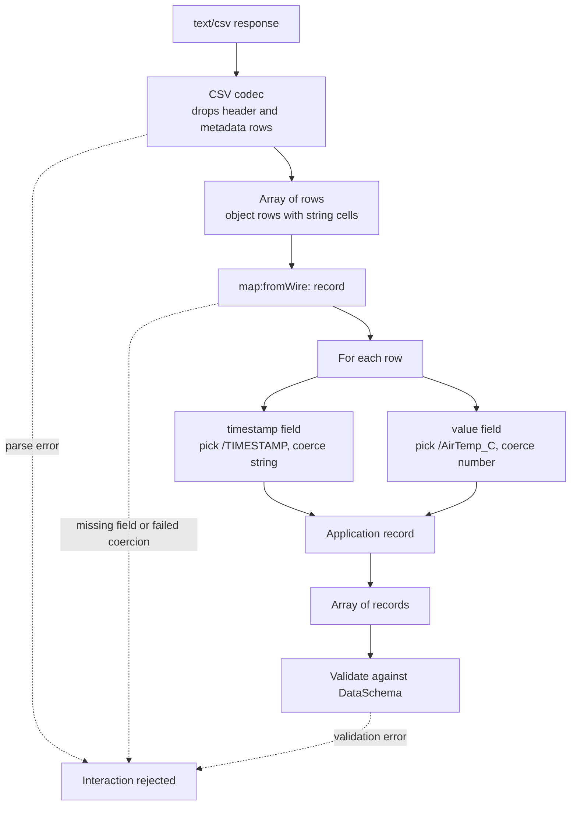

# Data Mapping: `map` Core and Payload Bindings

## Summary

**Proposal.**

1. **`map` core terms.** A small, format-neutral set of `map` terms covers the ordered read/write pipeline and the operations of user story 3 (numeric) and user story 4 (enum), plus the shared `record` and `coerce` operations. Integration into the TD core context is conditional on the WoT WG accepting the proposal. Until then, `map` remains a working vocabulary with its own prefix.
2. **Two ways to express math.** Basic mathematical operations can be written either with the limited built-in operations (`mul`, `add`, `reciprocal`, `round`, `clamp`) or with a `formula` placeholder that carries the formula itself and the identifier of its expression language.
3. **Protocol binding terms stay where they are.** Terms that protocol bindings already define (for example `lorav:multiplier`, `bacv:hasValueMap`, `profv:payloadMapping`) remain in their own contexts. They can be used in combination with `map` terms in the same form.
4. **Payload bindings live outside the core specification.** The JSON (`jsonv`), octet-stream (`octv`), and CSV (`csvv`, reusing CSVW) vocabularies are defined as payload bindings outside the core TD specification and are candidates for entries in the WoT Binding Registry.

**Layering.** A payload binding owns how wire bytes or characters become a JSON-like value or scalar. The `map` core owns the format-independent transformation of that value into the TD DataSchema value, and the inverse for writes.


For writes the same stages run in the opposite direction, with `map:toWire`.

**Why the split.** Several operators that looked generic assume one representation of the decoded value:

| Concern | Representation assumption | Layer |
|---|---|---|
| JSON navigation and construction | Decoded JSON object/array tree | JSON payload binding |
| Byte-range decoding and bitfield extraction/composition | Raw octets converted to a typed integer or structured fields | Octet-stream payload binding |
| CSV dialect, rows, and columns | Delimited text | CSV payload binding |
| Numeric and enum conversion | Decoded scalar | `map` core |
| Record projection and coercion | Decoded array or scalar | `map` core |

Protocol bindings such as PROFINET retain their existing terms for protocol-specific payload layout. The `octv` binding owns generic byte-range selection, byte-order interpretation, and bitfield operations for octet-stream payloads. When a protocol binding already expresses an equivalent decoding step, use its terms instead of applying the same decoding again through `octv`.

**Trade-off.** The core stays small and format-agnostic, at the cost of one binding vocabulary per payload family (JSON, octet-stream, CSV, and potentially others).

**Sources.** The analysis behind this decision is in [US2-details.md](./US2-details.md) (CSV), [US3-details.md](./US3-details.md) (numeric), [US4-details.md](./US4-details.md) (enum), [US5-details.md](./US5-details.md) (structure), and [analysis-data-mapping-summary.md](./analysis-data-mapping-summary.md).

## 1. `map` Core Terms

If the WoT WG accepts the `map` proposal, these terms will be integrated into the TD core context. Until then they use the working namespace `https://www.w3.org/wot/data-mapping/v1#` with prefix `map`. The JSON-LD context is in [Appendix A](#appendix-a-map-core-context).

### 1.1 Pipeline and operation dispatch

| Term | Purpose |
|---|---|
| `map:valueMapping` | Form-level container for a directional mapping pipeline. |
| `map:fromWire` | Ordered operations applied when reading (protocol to application). |
| `map:toWire` | Ordered operations applied when writing (application to protocol). A writable form without `map:toWire` must fail unless an unambiguous inverse is explicitly defined. |
| `map:proc` | Identifies the operation performed by one pipeline step. |
| `map:onError` | Per-operation runtime failure policy. `error` is the default; `skip` passes the unchanged input to the next operation. |

Rules shared by all operations:

- Operations run in document order and each receives the previous output.
- Direction is explicit per form. A reverse mapping is never guessed, because the two directions need not be symmetric (for example, a read may round while the write must preserve the application value).
- A runtime operation failure rejects the interaction by default. If that step declares `map:onError: "skip"`, the unchanged input passes to the next operation instead.
- Invalid operation objects and unknown or unsupported operations reject the interaction regardless of `map:onError`; `skip` does not suppress configuration or capability errors.

### 1.2 Numeric operations (user story 3)

Basic math can be expressed in two forms that can be mixed in one pipeline.

| `map:proc` | Parameters | Effect |
|---|---|---|
| `mul` | `map:value` | Multiply the current value by `map:value`. |
| `add` | `map:value` | Add `map:value` to the current value. |
| `reciprocal` | `map:value` | Replace the current value with `map:value / currentValue`. The current value must not be zero. |
| `round` | `map:mode` | Round according to `map:mode`: `floor`, `ceil`, `nearest` (half to even), or `towardZero`. |
| `clamp` | `map:min`, `map:max` | Constrain the current value to `[map:min, map:max]`. |
| `formula` (placeholder) | `map:formula`, `map:expressionLanguage` | Evaluate a formula written in a named expression language. |

| Term | Used by | Purpose |
|---|---|---|
| `map:value` | `mul`, `add`, `reciprocal` | Numeric constant operand. |
| `map:mode` | `round` | Rounding strategy. |
| `map:min`, `map:max` | `clamp` | Inclusive lower and upper bound. |
| `map:formula` | `formula` | The formula text. The current pipeline value is referenced by a variable whose name is still to be decided (see [Open questions](#3-open-questions)); `value` is used in the examples. |
| `map:expressionLanguage` | `formula` | IRI that identifies the language and version in which `map:formula` is written. |

`NaN` and infinity are invalid unless explicitly allowed. Rounding and clamping are separate steps, not implicit in arithmetic.

The `formula` operation is a placeholder: it standardizes only where the formula and its language are declared. Its semantics are defined by the identified language. It is a declarative, side-effect-free expression, not a general scripting facility. A consumer that does not support the named language must fail the interaction instead of ignoring the step.

Equivalent read mappings for Lion EMS cabinet temperature (deci-degrees to degrees):

```json
{
  "map:valueMapping": {
    "map:fromWire": [{ "map:proc": "mul", "map:value": 0.1 }]
  }
}
```

The formula example is illustrative only; its expression-language IRI is not proposed as a standard identifier.

```json
{
  "map:valueMapping": {
    "map:fromWire": [
      {
        "map:proc": "formula",
        "map:formula": "value * 0.1",
        "map:expressionLanguage": "https://example.org/expression-language/arithmetic"
      }
    ]
  }
}
```

The language IRI is a placeholder. Both forms can be combined with other operations, for example `formula` followed by `clamp`.

### 1.3 Enum operations (user story 4)

| `map:proc` | Effect |
|---|---|
| `enum` | Look up the current value in an exact wire/application table and replace it with the value from the other side. |
| `enumRange` | Find the numeric interval that contains the current value and replace it with that interval's application enum symbol. |

| Term | Used by | Purpose |
|---|---|---|
| `map:map` | `enum` | Ordered list of exact entries, each with one `map:wire` and one `map:app`. |
| `map:wire` | `enum` entry | Value in the protocol domain. |
| `map:app` | `enum` and `enumRange` entry | Value in the application domain. |
| `map:ranges` | `enumRange` | Ordered, non-overlapping list of range entries. |
| `map:min`, `map:max` | range entry | Inclusive interval bounds, with `min <= max`. |
| `map:canonical` | range entry | Wire value written for the application symbol. It must lie within the interval. |
| `map:onNoMatch` | `enum`, `enumRange` | Policy when nothing matches. `error` is the default. |
| `map:name` | `enum`, `enumRange` | Selects one member of a structured object to convert in place (same name in both directions, no renaming). |

Write-path rules:

- An exact mapping is writable when an unambiguous reverse table is present or derivable. Duplicate wire values or duplicate application values are invalid when both directions are declared.
- An `enumRange` mapping is many-to-one and therefore read-only unless every application symbol has an explicit `map:canonical` wire value. A runtime must not pick a midpoint, first, or last value.
- Unknown values produce `error` unless an explicit policy says otherwise. A runtime must not silently invent an enum value.
- Default composition with numeric operations: on read numeric operations run first, then enum mapping; on write the reverse enum mapping runs first, then the inverse numeric operations.

### 1.4 Collection and type operations (shared)

| Term | Purpose |
|---|---|
| `map:proc: "record"` | Apply named field pipelines to every element of an already-decoded array and return an array of application records. It does not parse CSV, classify rows, or choose the row shape. |
| `map:fields` | Object of named nested pipelines for `record`. Each pipeline receives the current row as its initial input. |
| `map:proc: "coerce"` | Convert the current value to a target type. Normative semantics are still open. |
| `map:type` | Target type of `coerce`. |
| `map:decimalSeparator` | Decimal separator `coerce` accepts for numeric text. |

A missing field, an invalid nested operation, or a failed coercion rejects the mapping. Example (a time series from decoded CSV rows):

```json
{
  "map:proc": "record",
  "map:fields": {
    "timestamp": [
      { "map:proc": "pick", "jsonv:path": "/TIMESTAMP" },
      { "map:proc": "coerce", "map:type": "string" }
    ],
    "value": [
      { "map:proc": "pick", "jsonv:path": "/AirTemp_C" },
      { "map:proc": "coerce", "map:type": "number" }
    ]
  }
}
```

### 1.5 Combination with protocol binding terms

Protocol bindings keep the terms they already define. `map` is added on top and is not a replacement for them.

| Binding | Existing terms (stay in the binding) | Relation to `map` |
|---|---|---|
| LoRaWAN (`lorav`) | `multiplier`, `divisor`, `offset`, `polynomial`, `transform`, `enum` | Same intent as `mul`, `add`, `formula`/pipeline, and `enum`. The binding terms remain valid; `map` may be used instead or in addition. |
| BACnet (`bacv`) | `hasValueMap`, `hasMapEntry`, `hasProtocolVal`, `hasLogicalVal`; `hasDataType` | `hasValueMap` corresponds to `enum`. `hasDataType` is wire-type metadata that is needed before any `map` operation runs. |
| PROFINET (`profv`) | `enumeratedValue`, `payloadMapping`, `byteOffset`, `byteLength`, `bitOffset`, `type`, `mostSignificantByte` | Protocol-specific layout and typing remain in the binding. Use those terms instead of an equivalent `octv` decoding step; apply `map` after decoding. |
| Modbus (`modv`) | `entity`, `type` | Register addressing and typing stay in the binding. |

Proposed evaluation order on read: the protocol binding selects the message or payload bytes and applies protocol-specific framing; the payload binding decodes the payload into a JSON-like value or scalar; then the `map:fromWire` pipeline runs. On write the order is reversed. Existing protocol terms remain in their namespaces, but an equivalent decoding operation must not be applied twice (see [Open questions](#3-open-questions)).

## 2. Payload Binding Contexts

JSON, octet-stream, and CSV vocabularies are payload bindings. They are defined outside the core specification, each with its own prefix, and are candidates for entries in the WoT Binding Registry (see [2.4](#24-inclusion-in-the-wot-binding-registry)). Each binding decodes its wire format down to a JSON-like value or scalar for the `map` core and encodes the reverse direction for writes. The JSON-LD contexts are in [Appendix B](#appendix-b-json-payload-binding-context-jsonv), [Appendix C](#appendix-c-octet-stream-payload-binding-context-octv), and [Appendix D](#appendix-d-csv-payload-binding-context-csvv-with-csvw).

The namespace IRIs below are working placeholders.

### 2.1 JSON payload binding (`jsonv`)

Namespace `https://www.example.org/wot/payload-binding/json/v1#`. Identified in a form by `contentType` `application/json`.

| Operation | Directional purpose | Result |
|---|---|---|
| `pick` | Read a value at a JSON Pointer | Selected value |
| `place` | Write the current value at a JSON Pointer | Structured container |
| `wrap` | Add a fixed envelope around the current value | Wrapped object or array |
| `unwrap` | Remove one known envelope layer | Contained value |
| `at` | Read one array element | Selected element |
| `setAt` | Replace one array element | Updated array |

| Term | Purpose |
|---|---|
| `jsonv:path` | JSON Pointer (RFC 6901) addressing an object member or array element. No query, filter, wildcard, or expression semantics. |
| `jsonv:onMissing`, `jsonv:default` | Policy and fallback value when the selected member is absent. `error` is the default policy. |
| `jsonv:createMissing`, `jsonv:targetTemplate` | Control creation of missing containers and the initial container for `place`. |
| `jsonv:template`, `jsonv:placeholder` | Define the JSON envelope constructed by `wrap` and the placeholder replaced by the current value. |
| `jsonv:index` | Non-negative array index for `at` and `setAt`. |

### 2.2 Octet-stream payload binding (`octv`)

Namespace `https://www.example.org/wot/payload-binding/octet-stream/v1#`. Identified in a form by `contentType` `application/octet-stream`.

| Operation | Directional purpose | Result |
|---|---|---|
| `bitExtract` | Read named fields from a decoded integer using masks and shifts | Structured object |
| `bitCompose` | Write structured fields into an integer using masks and shifts | Integer |

| Term | Purpose |
|---|---|
| `octv:byteOffset`, `octv:byteLength` | Byte range that represents the value. |
| `octv:byteOrder` | Byte-order interpretation of the selected range. |
| `octv:fields` | Ordered field definitions extracted from or composed into the integer. |
| `octv:fieldName`, `octv:fieldType` | Application-facing member name and its boolean or integer interpretation. |
| `octv:mask`, `octv:shift` | Select and align the bits of one field. Masks must be non-zero and non-overlapping; shifts non-negative. |

The `octv` binding decodes the selected byte range to an integer using `octv:byteOrder`, then `bitExtract` or `bitCompose` operates on that value. A writable form must declare the complete field list, because omitted bits would be composed as zero.

### 2.3 CSV payload binding (`csvv`, reusing CSVW)

Namespace `https://www.example.org/wot/payload-binding/csv/v1#`. Identified in a form by `contentType` `text/csv`.

[CSV on the Web (CSVW)](https://www.w3.org/TR/tabular-metadata/) already standardizes CSV dialect, column, and datatype metadata, and [CSV2JSON](https://www.w3.org/TR/csv2json/) defines how annotated tabular data becomes JSON. The CSV binding reuses them and defines `csvv` terms only for what CSVW does not cover.

Reused from CSVW (embedded in the form as JSON literals):

| Term | Purpose |
|---|---|
| `csvw:dialect` | CSVW dialect description: `delimiter`, `quoteChar`, `doubleQuote`, `encoding`, `lineTerminators`, `commentPrefix`, `skipRows`, `header`, `headerRowCount`. |
| `csvw:tableSchema` | CSVW schema whose `columns` give `name`, `titles`, `datatype` (`base`, `format`, including `decimalChar` and `groupChar`), `null`, `default`, `required`, `separator`, `suppressOutput`, `virtual`. |

`csvv` extensions:

| Term | Purpose |
|---|---|
| `csvv:metadataRows` | Row indexes or patterns classified as non-data after the header (for example a TOA5 units row or aggregation-qualifier row). |
| `csvv:dataRowPattern` | Rule that identifies which rows are observations. |
| `csvv:rowRepresentation` | `"object"` (a CSV2JSON minimal-mode row keyed by column `name`, values typed per `datatype.base`) or `"array"` (cells in column order). This is the decoded shape handed to `map`. |
| `csvv:tableDiscriminator` | Column used to route a row to a specific affordance or schema in a multiplexed stream. CSVW dialects do not cover multiple tables in one file. |

CSV concerns and their layer:

| CSV concern | Layer |
|---|---|
| Delimiter, quote and escape characters, encoding, decimal separator, dialect | CSV payload binding (CSVW `dialect`, column `datatype`) |
| Row-role classification (metadata, header, data); multi-table routing | CSV payload binding |
| Per-row shape: array of cells or object of named cells | CSV payload binding |
| Type coercion, missing and sentinel values | `map` core (`coerce`) |
| Timestamp normalization and timezone policy | `map` core (semantic rule independent of the wire format) |
| Quality/status side-channel mapping | `map` core (concerns where a value lands in the DataSchema) |

Example handoff from CSV decoding to the `map` core:

```json
{
  "op": ["readproperty"],
  "href": "http://logger.local/data.csv",
  "contentType": "text/csv",
  "csvw:dialect": { "delimiter": ",", "skipRows": 1, "headerRowCount": 1 },
  "csvw:tableSchema": {
    "columns": [
      { "name": "TIMESTAMP", "datatype": "string" },
      { "name": "AirTemp_C", "datatype": "number" }
    ]
  },
  "csvv:dataRowPattern": { "startRow": 4 },
  "csvv:rowRepresentation": "object",
  "map:valueMapping": {
    "map:fromWire": [
      { "map:proc": "pick", "jsonv:path": "/0/AirTemp_C" },
      { "map:proc": "mul", "map:value": 1 }
    ]
  }
}
```

`csvv:dataRowPattern.startRow` counts rows in the original CSV file, including rows skipped by `csvw:dialect.skipRows` and rows used as headers; it is not relative to the filtered data-row array.

The binding returns all decoded data rows. A scalar mapping selects a row explicitly (here `/0/...`); `record` maps all rows. Only the `name`-keyed minimal-mode output is used; `aboutUrl`, `propertyUrl`, `valueUrl`, and nested-object generation are not needed. Typed columns arrive as JSON numbers or booleans, so `coerce` is only needed for untyped columns or conversions CSVW cannot express. CSVW and CSV2JSON are read-oriented and define no CSV serialization; writes remain binding-defined.

### 2.4 Inclusion in the WoT Binding Registry

State as fetched on 2026-11-11: [WoT Binding Registry](https://w3c.github.io/wot-binding-registry/) editor's draft of 08 October 2026 and [Thing Description 2.0](https://www.w3.org/TR/wot-thing-description-2.0/) First Public Working Draft of 04 November 2025.

What the registry and the TD 2.0 draft say:

- The registry is a W3C Registry Track document in a pilot phase. Only bindings written by the WoT Working Group are included and they stay in status `Initial`. External submissions open after the pilot.
- A binding specification may target a protocol, a payload format, or both (TD 2.0, [Bindings](https://www.w3.org/TR/wot-thing-description-2.0/#bindings)). Payload bindings are described through `contentType` and the Data Schema, and registry entries are expected to define mappings from data schemas to other content types such as XML. TD Processors should expand the `@context` with the prefixes of registered bindings.
- A registry entry has these characteristics: name, version, status (`Initial`, `Current`, `Superseded`, `Obsolete`), binding document link, target specification, summary document link, vocabulary term prefix (unique), binding identification in the TD (for example `"contentType":"application/json"`), and supported TD versions.
- A binding that uses a serialization format through `contentType` must describe how the Data Schema terms are used to describe the messages.
- Required content sections are defined for protocol bindings. The section for media-type (payload) bindings is an editor's note: it will be defined in a future revision and additional vocabulary mechanisms will be required.
- Supporting documents: a summary document, a JSON Schema validating the binding's terms (required), and a JSON-LD context and an RDF vocabulary (recommended). All carry the same version string.
- A binding's namespace must not be redefined or extended by another binding, and bindings must not duplicate concepts of other entries.
- Submission and transitions go through GitHub issue templates with reviewers. Moving to `Current` needs a test report with at least one Consumer and one Exposer implementation, and for protocol bindings a full IANA URI scheme registration.
- The TD 2.0 draft lists JSON/CBOR and XML/EXI as content types that may use a Data Schema. `text/csv` and `application/octet-stream` appear only as content type examples.

Proposed registry entries (all values are proposals):

| Characteristic | JSON binding | Octet-stream binding | CSV binding |
|---|---|---|---|
| Vocabulary term prefix | `jsonv` | `octv` | `csvv` (reuses `csvw`) |
| Binding identification in TD | `"contentType": "application/json"` | `"contentType": "application/octet-stream"` | `"contentType": "text/csv"` |
| Target specification | JSON (RFC 8259), JSON Pointer (RFC 6901) | None; layouts come from protocol or device specifications | CSV (RFC 4180), CSVW metadata vocabulary, CSV2JSON |
| Status when submitted | `Initial` | `Initial` | `Initial` |
| Supporting documents | Summary, JSON Schema, JSON-LD context ([Appendix B](#appendix-b-json-payload-binding-context-jsonv)), RDF vocabulary | Same ([Appendix C](#appendix-c-octet-stream-payload-binding-context-octv)) | Same ([Appendix D](#appendix-d-csv-payload-binding-context-csvv-with-csvw)) |

Proposed path:

1. Write one binding document per payload binding with the registry's required parts (target specification, form vocabulary table, default and possible mappings, description of Data Schema use, changelog), plus the supporting documents.
2. Contribute the missing media-type binding requirements to the registry (an issue on [w3c/wot-binding-registry](https://github.com/w3c/wot-binding-registry)), using these three bindings as the first concrete cases.
3. Submit the entries as `Initial` once the registry accepts external submissions, then collect test reports (a Consumer and an Exposer implementation) for `Current`.
4. If the WoT WG accepts the `map` terms into the TD core context, keep `map` out of the registry and have payload bindings depend on that core definition. If it does not, decide whether `map` needs a separate publication or registry path before submitting dependent payload bindings.

## 3. Open Questions

**`map` core**

1. **Formula placeholder.** Which expression language(s) are allowed, how is the current value referenced in `map:formula`, how are numeric edge cases (NaN, infinity, integer overflow) handled, what limits apply to evaluation, and should a minimal language be mandatory for interoperability? The scope statements of [US3](./US3-details.md) and [US4](./US4-details.md) exclude arbitrary code execution and scripting; they need rewording to say that declarative formulas are in scope. Is FnO (evaluated in US3 as optional enrichment) a candidate?
2. **Write direction for formulas.** Formulas are directional like all operations; is there ever an implicit inverse, or must `map:toWire` always spell it out?
3. **`coerce`.** Normative semantics are open: target types, conversion failures, empty values, explicit sentinel replacement, and how `map:decimalSeparator` relates to the CSV decimal character.
4. **`record`.** Is a write direction needed, and how do nested `map:fields` pipelines interact with binding operations such as `pick`?
5. **Policies.** The `default` value of `map:onNoMatch` needs a defined default model. The complete value sets of `map:onError` need confirming.
6. **TD context integration.** Integration of `map` into the TD core context is conditional on WoT WG acceptance. If it is not accepted, should `map` remain an external extension, and what publication path should payload bindings use for that dependency? Separately, `map:valueMapping` is a JSON literal, so the operations inside are not RDF-visible. Is that acceptable, or should the pipeline be expanded to RDF? The contexts in the appendix use prefixed term definitions because compact aliases from earlier drafts (`op`, `default`, `name`, `type`) collide with TD terms.

**Protocol binding coexistence**

7. **Precedence.** When a form carries both a binding term (for example `lorav:multiplier`) and a `map` operation with the same effect, which applies, and how is double application avoided?
8. **Alignment.** Do binding authors (LoRaWAN, BACnet, PROFINET, Modbus) agree with keeping their terms and adding `map` on top, and which terms, if any, should later be deprecated?

**Payload bindings and registry**

9. **Namespaces.** The binding namespaces are placeholders. Who hosts the namespaces and contexts once the bindings are outside the core specification?
10. **Byte-decoding overlap.** `octv` owns generic byte-range decoding, while protocol bindings retain terms such as `profv:byteOffset`, `profv:mostSignificantByte`, and `modv:type`. How should protocol-specific terms select or parameterize `octv` decoding, and how should consumers distinguish that from a protocol binding that performs the decoding itself?
11. **Multi-field payloads.** How does a payload binding describe several independently positioned, differently typed fields (see [issue #1936](https://github.com/w3c/wot-thing-description/issues/1936)), kept distinct from `bitExtract` and `bitCompose`?
12. **Additional conversions.** Is a future operation needed to reinterpret extracted bits as an IEEE-754 float, or to format an epoch integer as a timestamp string? Neither is covered by user stories 3 and 4.
13. **Registry requirements.** What are the required sections for media-type bindings, what replaces the IANA URI scheme requirement for payload bindings, which TD versions do the bindings target, and which Exposer implementations can contribute to a test report?
14. **TD 2.0 content types.** Should the TD 2.0 table of content types that may use a Data Schema be extended with `text/csv` and `application/octet-stream` once the bindings exist?

**CSV**

15. **CSVW reuse.** Is embedding `csvw:dialect` and `csvw:tableSchema` as JSON literals (instead of expanding them to RDF) acceptable? How are they mapped onto the options of CSV parsers, and which CSVW defaults apply?
16. **Row classification.** Can `csvv:metadataRows` and `csvv:dataRowPattern` be expressed with `skipRows` and `headerRowCount` alone? Are `dataRowPattern` and `tableDiscriminator` needed at all?
17. **Writes.** How is CSV serialization defined when CSVW and CSV2JSON are read-oriented?

## Appendix A: `map` Core Context

Working context for [section 1](#1-map-core-terms). Terms are declared with prefixed names so that they do not collide with TD terms such as `op`, `default`, `name`, or `type`.

```json
{
  "@context": {
    "@version": 1.1,
    "map": "https://www.example.org/wot/data-mapping/v1#",
    "xsd": "http://www.w3.org/2001/XMLSchema#",
    "map:valueMapping": { "@id": "map:valueMapping", "@type": "@json" },
    "map:fromWire": { "@id": "map:fromWire", "@container": "@list" },
    "map:toWire": { "@id": "map:toWire", "@container": "@list" },
    "map:proc": { "@id": "map:proc", "@type": "xsd:string" },
    "map:onError": { "@id": "map:onError", "@type": "xsd:string" },
    "map:fields": { "@id": "map:fields", "@type": "@json" },
    "map:value": { "@id": "map:value", "@type": "xsd:decimal" },
    "map:mode": { "@id": "map:mode", "@type": "xsd:string" },
    "map:min": { "@id": "map:min", "@type": "xsd:decimal" },
    "map:max": { "@id": "map:max", "@type": "xsd:decimal" },
    "map:formula": { "@id": "map:formula", "@type": "xsd:string" },
    "map:expressionLanguage": { "@id": "map:expressionLanguage", "@type": "@id" },
    "map:map": { "@id": "map:map", "@container": "@list" },
    "map:ranges": { "@id": "map:ranges", "@container": "@list" },
    "map:onNoMatch": { "@id": "map:onNoMatch", "@type": "xsd:string" },
    "map:name": { "@id": "map:name", "@type": "xsd:string" },
    "map:type": { "@id": "map:type", "@type": "xsd:string" },
    "map:decimalSeparator": { "@id": "map:decimalSeparator", "@type": "xsd:string" }
  }
}
```

`map:wire`, `map:app`, and `map:canonical` need no declaration; they hold arbitrary scalar values.

## Appendix B: JSON Payload Binding Context (`jsonv`)

Working context for [section 2.1](#21-json-payload-binding-jsonv). `jsonv:default`, `jsonv:targetTemplate`, and `jsonv:template` hold arbitrary JSON and are therefore JSON literals.

```json
{
  "@context": {
    "@version": 1.1,
    "jsonv": "https://www.example.org/wot/payload-binding/json/v1#",
    "xsd": "http://www.w3.org/2001/XMLSchema#",
    "jsonv:path": { "@id": "jsonv:path", "@type": "xsd:string" },
    "jsonv:onMissing": { "@id": "jsonv:onMissing", "@type": "xsd:string" },
    "jsonv:default": { "@id": "jsonv:default", "@type": "@json" },
    "jsonv:createMissing": { "@id": "jsonv:createMissing", "@type": "xsd:boolean" },
    "jsonv:targetTemplate": { "@id": "jsonv:targetTemplate", "@type": "@json" },
    "jsonv:template": { "@id": "jsonv:template", "@type": "@json" },
    "jsonv:placeholder": { "@id": "jsonv:placeholder", "@type": "xsd:string" },
    "jsonv:index": { "@id": "jsonv:index", "@type": "xsd:integer" }
  }
}
```

## Appendix C: Octet-Stream Payload Binding Context (`octv`)

Working context for [section 2.2](#22-octet-stream-payload-binding-octv). This context assigns generic byte-range selection and byte-order decoding to `octv` before bitfield extraction or composition.

```json
{
  "@context": {
    "@version": 1.1,
    "octv": "https://www.example.org/wot/payload-binding/octet-stream/v1#",
    "xsd": "http://www.w3.org/2001/XMLSchema#",
    "octv:byteOffset": { "@id": "octv:byteOffset", "@type": "xsd:nonNegativeInteger" },
    "octv:byteLength": { "@id": "octv:byteLength", "@type": "xsd:positiveInteger" },
    "octv:byteOrder": { "@id": "octv:byteOrder", "@type": "xsd:string" },
    "octv:fields": { "@id": "octv:fields", "@container": "@list" },
    "octv:fieldName": { "@id": "octv:fieldName", "@type": "xsd:string" },
    "octv:mask": { "@id": "octv:mask", "@type": "xsd:integer" },
    "octv:shift": { "@id": "octv:shift", "@type": "xsd:nonNegativeInteger" },
    "octv:fieldType": { "@id": "octv:fieldType", "@type": "xsd:string" }
  }
}
```

## Appendix D: CSV Payload Binding Context (`csvv`, with CSVW)

Working context for [section 2.3](#23-csv-payload-binding-csvv-reusing-csvw). The CSVW entry points are JSON literals, so CSVW property names inside them do not collide with TD terms such as `format`, `default`, or `required`.

```json
{
  "@context": {
    "@version": 1.1,
    "csvw": "http://www.w3.org/ns/csvw#",
    "csvv": "https://www.example.org/wot/payload-binding/csv/v1#",
    "xsd": "http://www.w3.org/2001/XMLSchema#",
    "csvw:dialect": { "@id": "csvw:dialect", "@type": "@json" },
    "csvw:tableSchema": { "@id": "csvw:tableSchema", "@type": "@json" },
    "csvv:metadataRows": { "@id": "csvv:metadataRows", "@container": "@list" },
    "csvv:dataRowPattern": { "@id": "csvv:dataRowPattern", "@type": "@json" },
    "csvv:rowRepresentation": { "@id": "csvv:rowRepresentation", "@type": "xsd:string" },
    "csvv:tableDiscriminator": { "@id": "csvv:tableDiscriminator", "@type": "xsd:string" }
  }
}
```

## Appendix E: node-wot Implementation

The node-wot prototype is an implementation experiment, not a normative resolution of the decisions and open questions above.

### Mapping pipeline

- `map:proc` supports `pick`, `coerce`, and `record` in `fromWire`.
- `coerce` supports string, number, integer, and boolean targets. Empty values become `null`, and sentinel replacement must be declared explicitly.
- `map:toWire` and CSV serialization are not implemented.
- Parse, mapping, coercion, and DataSchema errors reject the interaction.
- The legacy `nw:valuePath` remains supported.

Example: a read of a CSV time series with a `record` mapping (`pick` and `coerce` per field). Any failing step rejects the interaction.



### CSV codec

- The prototype still uses the `csvv:` dialect terms listed below instead of `csvw:dialect` and `csvw:tableSchema`.
- It requires `csvv:rowRepresentation` per form, filters the configured header and metadata rows, returns string-valued cells, and is read-only.
- `csvv:dataRowPattern` and `csvv:tableDiscriminator` are not implemented.
- `csvv:decimalSeparator` is validated but does not drive conversion. Comma-decimal conversion is configured with `map:decimalSeparator` on a `coerce` step.
- Each `readProperty()` rereads and decodes the resource; there is no shared decode cache.

The prototype-to-target correspondences below refer to the CSVW terms described in [Section 2.3](#23-csv-payload-binding-csvv-reusing-csvw):

| Prototype term | Target |
|---|---|
| `csvv:delimiter`, `csvv:quoteChar`, `csvv:encoding`, `csvv:commentPrefix` | Same-named `csvw:dialect` properties |
| `csvv:recordDelimiter` | `csvw:dialect.lineTerminators` |
| `csvv:escapeChar` | `csvw:dialect.doubleQuote` (`"` or `\` only) |
| `csvv:headerRow` | `csvw:dialect.skipRows` and `headerRowCount` |
| `csvv:columns` | `csvw:tableSchema.columns[].name` |
| `csvv:decimalSeparator` | `decimalChar` in a column `datatype.format` |
| `csvv:metadataRows`, `csvv:dataRowPattern`, `csvv:rowRepresentation`, `csvv:tableDiscriminator` | Retained as `csvv` extensions |

### Implementation questions

- How are `csvw:dialect` and `csvw:tableSchema` mapped onto the `csv-parse` options?
- Should several property reads of one CSV resource share a decoded copy?
- node-wot is the Consumer implementation available for a registry test report; an Exposer implementation is still needed.
